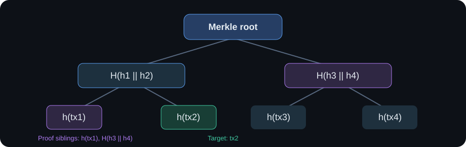

# DeFi & Blockchain

A collection of Python experiments exploring the mathematical foundations of blockchain systems: Bitcoin private-key probabilities, hash functions, Merkle proofs, and Proof-of-Work mining.

[](https://www.python.org/) 

## Projects

| Project | Research focus | Methods | Status |
|---|---|---|---|
| [HW1 · Cryptography](homeworks/hw01-cryptography/solution.ipynb) | Bitcoin key collisions, custom hashing, Merkle membership proofs | Monte Carlo, statistics, elliptic curves, SHA-256 comparison | Completed |
| [HW2 · Proof of Work](homeworks/hw02-proof-of-work/solution.ipynb) | Nonce search, network mining, mining difficulty | Simulations, block hashes, hash-rate experiments | Completed |
| [HW3 · Upcoming](homeworks/hw03-upcoming/) | To be announced | — | Planned |

## HW1 — Cryptography

**Question:** How small is the risk that a randomly generated Bitcoin private key duplicates an existing one?

For a key space of approximately `n−1` valid private keys and `N` existing keys, the first-order probability is approximately `P ≈ N / (n−1)`. The experiment investigates this estimate by experimenting with smaller elliptic-curve groups and comparing theory to observed collisions.



*Merkle proof illustration: verify tx2 using the sibling hash of tx1 and the hash of the tx3/tx4 subtree.*

Other experiments: testing an custom hash function for determinism, performance, avalanche effect, uniformity, chi-squared statistic, collisions and output-bit balance; implementing Merkle proof generation and membership verification.

**Important:** A home-built hash is not suitable for production cryptographic security. Statistical tests do not establish collision or preimage resistance.

**Explore:** [HW1 notebook](homeworks/hw01-cryptography/solution.ipynb) · [Task description](homeworks/hw01-cryptography/assignment.md)

## HW2 — Proof of Work

**Question:** How do miner hash rates and difficulty influence block discovery?

Experiments include block construction, a Proof-of-Work nonce search, different peer hash rates and observed mining times across difficulty settings. For a simplified target requiring `d` leading hex zeroes in an ideal hash, a single independent attempt succeeds with probability `16^(−d)`, so the expected number of attempts is `16^d`.

**Dependency:** [BlockchainExample](https://github.com/0xBoringWozniak/BlockchainExample) — third-party blockchain implementation used in the mining experiments.

**Explore:** [Open the HW2 notebook](homeworks/hw02-proof-of-work/solution.ipynb) · [Experiment notes](homeworks/hw02-proof-of-work/README.md)

## Skills

`Python` · `Jupyter` · `Monte Carlo` · `Probability & statistics` · `Hash functions` · `Merkle trees` · `Blockchain` · `Proof of Work` · `SageMath` · `Data visualization`

## Repository structure

```text
.
├── README.md
├── homeworks/
│   ├── hw01-cryptography/
│   │   ├── README.md
│   │   ├── solution.ipynb
│   │   └── assignment.md
│   ├── hw02-proof-of-work/
│   │   ├── README.md
│   │   └── solution.ipynb
│   └── hw03-upcoming/
│       └── README.md
└── .gitignore
```

## Running the experiments

Open the notebooks in Jupyter. Some HW1 cells require a **SageMath kernel**; HW2 uses the third-party **BlockchainExample** implementation linked above. Saved outputs are included, and execution environments may need adjustment depending on local dependencies.

## Roadmap

- [x] HW1 — Cryptography and Merkle proofs
- [x] HW2 — Proof-of-Work experiments
- [ ] HW3 — Next blockchain experiment
- [ ] Add reproducible environment setup
- [ ] Add selected plots and experiment comparisons to the overview
